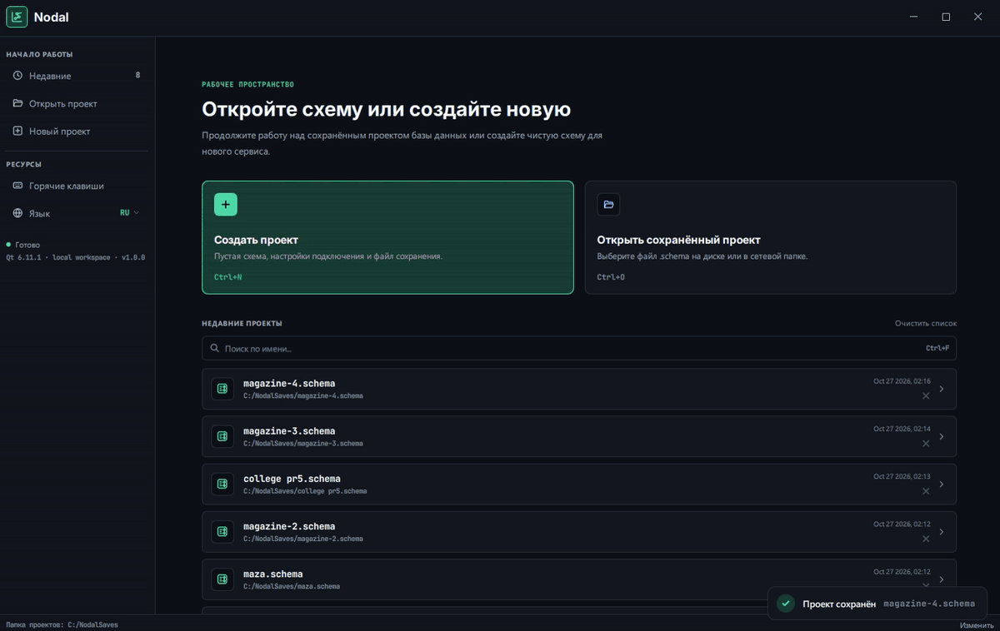

# Nodal

Desktop editor for database schemas: ER diagrams, SQL import and export.


**English** • [Русский](README_ru.md)

Place tables on an infinite canvas, connect them with relations and get ready-to-run SQL
for PostgreSQL, MySQL or SQLite. Or go the other way: paste existing `CREATE TABLE` code
and get a diagram. The diagram and the SQL always stay in sync — no rewriting by hand.



## Stack

| | |
|---|---|
| Language | C++17, QML, JavaScript |
| Framework | Qt 6.11 (Qt Quick, Quick Controls 2) |
| Build | CMake |
| Window | [QWindowKit](https://github.com/stdware/qwindowkit) |
| Storage | JSON (`.schema` files) |
| Platform | Windows |

## Features

Everything you need to design a schema, from the first table to the final SQL.

- Infinite canvas: zoom, pan, table search
- Tables: columns, types, PK / FK, colors, comments
- Relations `1:1`, `1:M`, `M:1`
- PostgreSQL, MySQL, SQLite: types are converted when switching the database
- Import SQL (`CREATE TABLE`, `FOREIGN KEY`, `ALTER TABLE`)
- Export SQL for the selected database, export PNG
- Windows 11 Snap Layouts, custom title bar
- English / Russian

## Build

Requires Qt 6.5+, CMake 3.19+, MinGW or MSVC.

```bash
git clone --recursive https://github.com/<your-username>/Nodal.git
cd Nodal
cmake -S . -B build -DCMAKE_PREFIX_PATH=<path-to-Qt>
cmake --build build --config Release
```

Or open `CMakeLists.txt` in Qt Creator. Don't forget `--recursive`: the window library
QWindowKit is a git submodule. If you already cloned without it, run `git submodule update --init --recursive`.

## Structure

C++ handles files and models, QML handles the interface, SQL parsing and generation are in plain JavaScript.

```
main.cpp, Main.qml        entry point, window
SqlTypes.qml              data types per database
storage/                  C++: save / load projects
models/                   C++: table search
Pages/ProjectLauncher/    start screen
Pages/SchemaWorkspace/    editor, canvas, SQL import / export
3rdparty/qwindowkit/      git submodule
```
